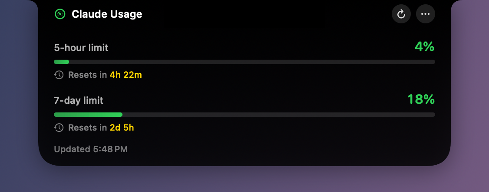

# ClaudeUsageBar

A small macOS menu bar app that shows your current Claude usage limits and when they reset.


The title shows, from left to right:

- **Limit** (gauge icon): the 5 hour and 7 day usage as a percentage.
- **Reset on** (clock icon): the time left until each limit resets.

Each value has a small `5h` or `7d` label above it, like the system's own menu bar stats.

On a Mac with a notch, if showing the stats would push other menu bar icons behind the notch, the stats leave the menu bar and move into a black island around the notch, so all your other icons stay visible. Every other connected display gets the same island, hanging from the middle of its menu bar, since the menu bar item is hidden on all displays at once. Hover over the island and it expands with progress bars, reset times and buttons to refresh or open the menu.



The app reads the login that Claude Code already stores on your Mac, so there is nothing to configure.

## Requirements

- macOS 13 or later
- Xcode command line tools (provides `swiftc` and `codesign`). Install with `xcode-select --install`.
- Claude Code installed and logged in with a Claude subscription account (Pro or Max)

## Installation

1. Clone or copy this folder to your Mac.

2. Build the app:

   ```bash
   cd ClaudeUsageBar
   ./build.sh
   ```

   This produces `ClaudeUsageBar.app` in the same folder.

3. Move the app to your Applications folder (optional but recommended):

   ```bash
   mv ClaudeUsageBar.app /Applications/
   ```

4. Launch it:

   ```bash
   open /Applications/ClaudeUsageBar.app
   ```

   The usage stats appear in the menu bar, or in the notch island if the menu bar has no room for them. There is no Dock icon.

5. On first launch macOS asks whether `security` may access the Keychain item named "Claude Code-credentials". Choose **Always Allow** so it does not ask again.

6. To start it automatically, open the app menu (click the menu bar item, or hover over the notch and click `⋯`) and choose **Launch at Login**.

Because the app is signed ad hoc, macOS may block it if you download a prebuilt copy from elsewhere. Building it locally with `build.sh` avoids this. If it is blocked, right-click the app and choose **Open**.

## Usage

Click the menu bar item to open the menu. While the stats are in the notch island, use the island's `⋯` button or right-click the island instead.

| Item | Description |
| --- | --- |
| Updated at ... | Time of the last successful refresh, plus the error if one occurred |
| Refresh Now | Fetch usage immediately (Cmd+R) |
| Launch at Login | Toggle automatic start at login |
| Show in Notch | Where the stats appear: **When Icons Would Be Hidden** (default) uses the island only when the menu bar has no room for them, **Always** uses the island, **Never** uses the menu bar. The stats are shown in one place at a time. |
| Quit | Close the app (Cmd+Q) |

Usage is fetched every 60 seconds and again after the Mac wakes from sleep. The reset countdowns update every 30 seconds.

### Notch island

- **Collapsed**: nothing is shown; the island is hidden in the notch until you hover over it. On displays without a notch it is a small black stand-in notch in the middle of the menu bar.
- **Expanded**: hover over the island to open it. It shows a progress bar and reset countdown for each limit, the last update time, a refresh button and a button that opens the app menu. Right-clicking the island also opens the menu. Move the pointer away to close it.

While the stats are in the island there is no menu bar item, so open the menu with the island's `⋯` button or by right-clicking the island.

The space check runs every few seconds, so the stats move back to the menu bar soon after other icons are removed. With **When Icons Would Be Hidden**, the space is measured on the notched screen, so a Mac without a notch keeps the stats in the menu bar. With **Always**, every display gets an island.

Countdown format: under one day it shows hours and minutes (`4h 22m`), otherwise days and hours (`2d 5h`).

### Status messages

These appear next to the gauge icon in the menu bar, or in the expanded island, until the first successful refresh.

| Message | Meaning |
| --- | --- |
| `Not logged in to Claude Code` | No Claude Code login was found in the Keychain or in `~/.claude/.credentials.json`. Log in with Claude Code. |
| `Login expired — open Claude Code` | The stored token was rejected. Open Claude Code once so it refreshes the login. |
| `Offline` | The usage request failed. The app retries on the next refresh. |
| A warning sign after the numbers (or in the expanded island's footer) | The latest refresh failed, so the numbers shown are from the previous successful one. |

### Command line check

To print the title text to the terminal without starting the menu bar app:

```bash
./ClaudeUsageBar.app/Contents/MacOS/ClaudeUsageBar --print
```

Example output:

```
Limit: 5h 4% 7d 18%  |  Reset on: 5h 4h 22m 7d 2d 5h
```

## How it works

1. The OAuth access token is read from the Keychain item "Claude Code-credentials" (or `~/.claude/.credentials.json` as a fallback).
2. The app calls `https://api.anthropic.com/api/oauth/usage` and reads the `five_hour` and `seven_day` utilization and reset times.
3. The result is drawn into the menu bar title with SwiftUI.
4. The app adds up the widths of all menu bar icons on the notched screen, including ones macOS has hidden behind the notch. If they plus the stats don't fit right of the notch, the stats are shown in the notch island instead of the menu bar.

The token is only sent to `api.anthropic.com`. It is not stored or logged by this app.

The usage endpoint is undocumented and may change without notice. If it does, the app will show an error until it is updated.

## Customizing

Everything lives in `main.swift`.

- Colors and icons: `Palette` (usage and reset colors, SF Symbol names)
- Menu bar layout and font sizes: `MenuBarView` and `StackedStat`
- Island sizes: `IslandMetrics` (expanded size, stand-in notch width)
- Island look and animation: `IslandView` (gradient, corner radii, spring) and `IslandShape` (outline)
- When the island is used: `statsWouldHideIcons` in `AppDelegate`
- Refresh interval: the timer in `applicationDidFinishLaunching`

After editing, run `./build.sh` again and relaunch the app.

## Uninstall

Quit the app from its menu, then delete `ClaudeUsageBar.app`. If you enabled Launch at Login, turn it off first from the menu.

## Project layout

```
ClaudeUsageBar/
  main.swift      App source
  build.sh        Builds and signs ClaudeUsageBar.app
  docs/           README screenshots
  README.md
```
